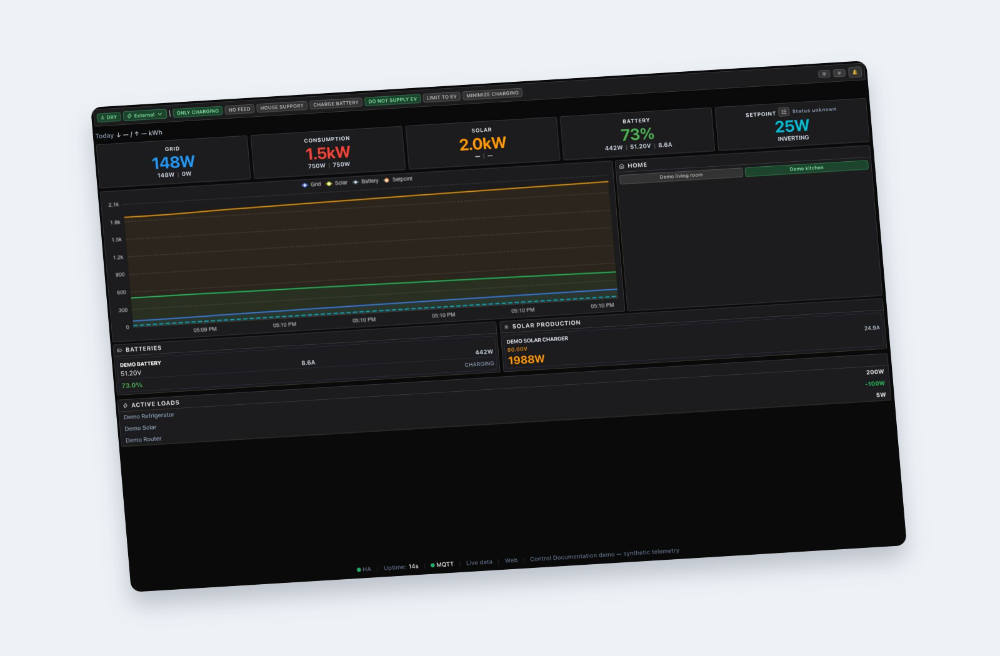
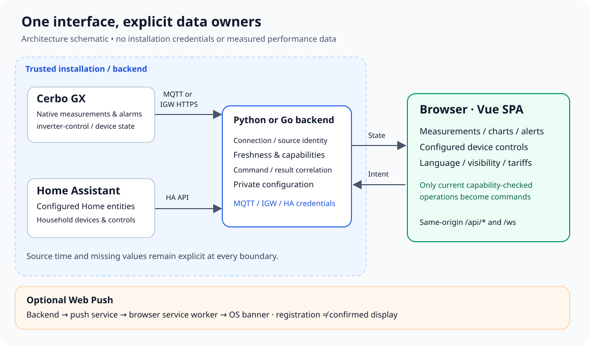
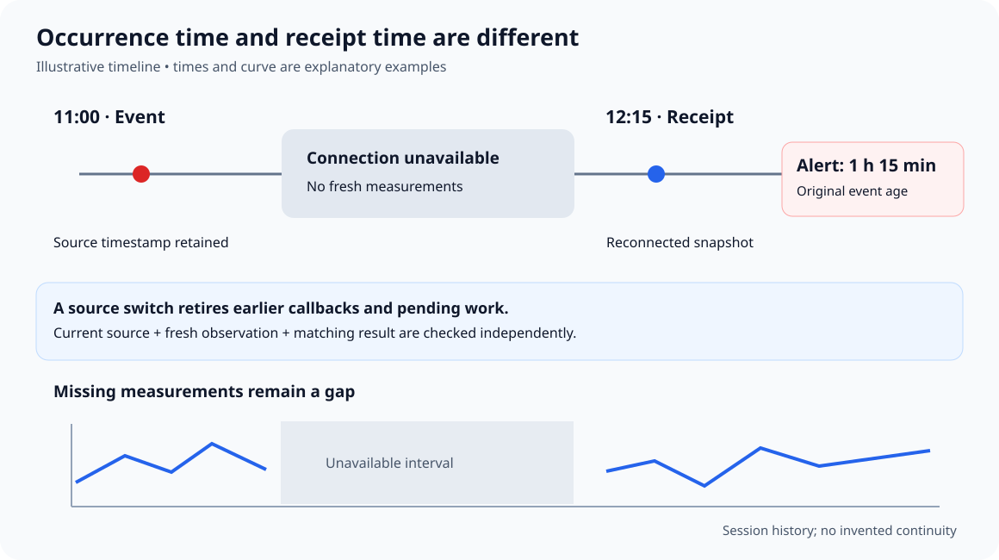

# Inverter-Dashboard-Oberfläche

[English](README.md) · [Русский](README.ru.md) · [Українська](README.uk.md) · [Deutsch](README.de.md) · [Français](README.fr.md) · [Nederlands](README.nl.md)

Der [visuelle Leitfaden zu Ablauf und Ergebnissen](docs/process-and-results.md) (auf Englisch) erklärt das implementierte Verhalten, die Auslieferungsschritte, die Vollständigkeit der Übersetzungsschlüssel und die Grenzen der Prüfungen.

Gemeinsame Vue-Oberfläche für die Python- und Go-Dashboards: Energiedaten, Victron-Warnungen, Home-Assistant-Steuerung und Stromtarife. Installieren Sie für den normalen Betrieb einen der Backends und öffnen Sie dessen Adresse. Dieses Repository enthält weder einen MQTT-Broker noch einen eigenständigen Server.

- [Python / FastAPI](https://github.com/victron-venus/inverter-dashboard)
- [Go](https://github.com/victron-venus/inverter-dashboard-go)

[](docs/images/vue-demo.jpg)

*Gemeinsame Vue-Oberfläche v2.2.9 mit synthetischen Demodaten. Klicken Sie auf das Bild, um den ursprünglichen Screenshot zu öffnen.*

[Bildquelle und erneute Erstellung (Englisch)](docs/images/README.md).

## Funktionen

Netz-, Verbrauchs-, Solar- und Batteriewerte unterscheiden gemessene Nullwerte von fehlenden Daten. Die sechs ESS-Modi, Controller-Schalter, Water-Steuerung und Sollwertvorgabe erfordern aktuelle Daten und passende Backend-Fähigkeiten. Home-Schaltflächen stammen aus der Konfiguration; inaktive Geräte bleiben ausgeblendet. Active Loads, Diagramme und Warnungen folgen den gemeinsamen Desktop-Regeln.



## Entwicklungsumgebung

Verwenden Sie die Node-Version aus der aktuellen CI und die Lockdatei. Vite startet normalerweise auf Port 5173. Live-Daten benötigen ein Backend mit `/api/*` und `/ws` unter derselben Origin; Vite allein verbindet keinen Wechselrichter. Für eine fertige Installation gelten die Anleitungen der Python- bzw. Go-Backends.

```sh
npm ci
npm run dev
```

```sh
npm run typecheck
npm run lint
npm test
npm run build:all
```

## Einstellungen und Sprachen

Settings enthält Sprache, Abschnittssichtbarkeit, Tarife und Benachrichtigungen. Verfügbar sind English, Русский, Українська, Deutsch, Français und Nederlands. Eine ausdrückliche Auswahl hat Vorrang vor der Browsersprache; Englisch dient als Rückfall. Vom Betreiber vergebene Gerätenamen bleiben unverändert. Zugangsdaten und Verbindungseinstellungen gehören auf den Server.

## Warnungen und Verlauf

Das Banneralter bezieht sich auf den Ereigniszeitpunkt, nicht auf den Empfang nach einer Wiederverbindung. Unbekannte Zeit wird nicht als „gerade eben“ dargestellt. Fehlende Messungen erzeugen Diagrammlücken. Der Sitzungspuffer umfasst höchstens 1800 Punkte und ist kein dauerhaftes Tagesarchiv. Systemmeldungen benötigen Browserfreigabe und serverseitiges Web Push. Ein angenommener Test bestätigt noch kein sichtbares Betriebssystembanner.



## Bereitstellung und Sicherheit

Die Build-Ausgaben heißen `dist/` für die Anwendung und `dist-lib/` für die Bibliothek. Installierte Backends erhalten Änderungen erst nach Übernahme des geprüften Pakets und erneuter Bereitstellung. Desktop besitzt einen eigenen Quellbaum und native Funktionen. Private Home-Einträge gehören in von Git ausgeschlossene Einstellungen. Keine IGW-/Cloudflare-Tokens in `VITE_*` speichern und TLS-Prüfung nicht deaktivieren.

```sh
VITE_PUBLIC_MODE=true npm run build:spa
```

## Fehlersuche

Seite nicht erreichbar: DNS, VPN-Routen, TLS und Ingress prüfen. Veraltete Daten: Browser → Backend → IGW → Cerbo getrennt untersuchen. Deaktivierte Schaltfläche: Zustand, Aktualität und Fähigkeiten prüfen, ohne Schutzmechanismen zu entfernen. Bei fehlenden Systemmeldungen Registrierung und tatsächliche Zustellung getrennt prüfen.

## Dokumentation

- [README (English)](README.md)
- [Wiki / configuration / troubleshooting (English)](docs/wiki/Home.md)
- [Localization (English)](docs/localization.md)
- [Tariffs (English)](docs/electricity-tariffs.md)
- [HTTPS (English)](deploy/https/README.md)
- [Contributing (English)](CONTRIBUTING.md)
- [Security (English)](SECURITY.md)
- [Release policy (English)](RELEASING.md)
- [MIT License](LICENSE)
