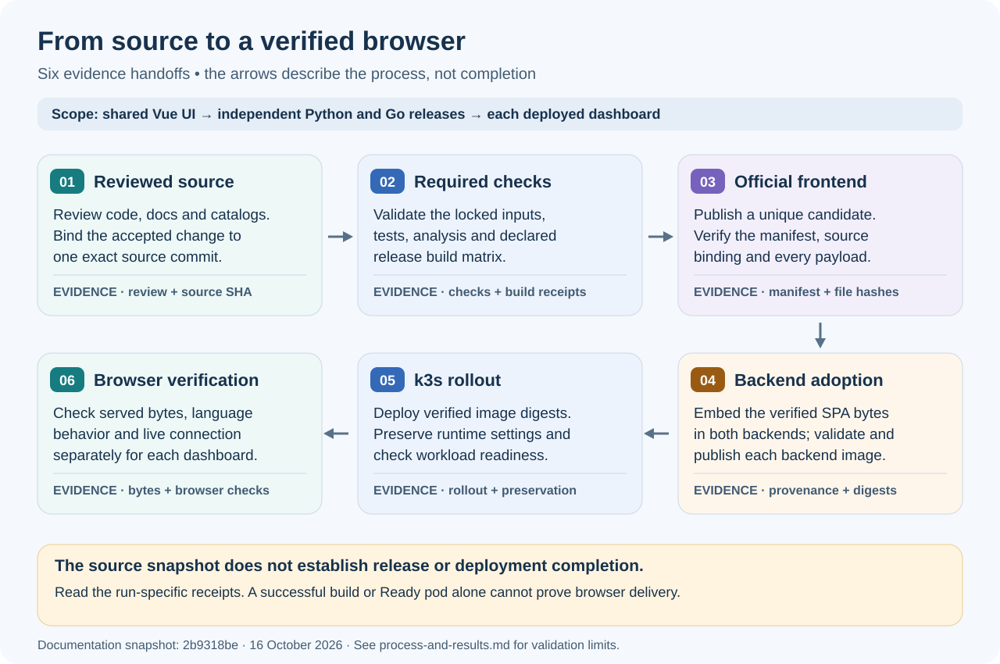
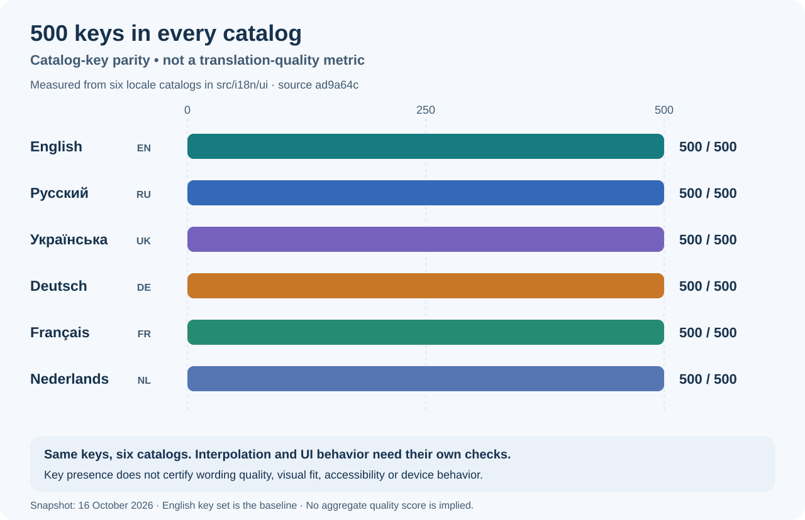

# Process and results

The shared Vue UI supplies both the Python and Go dashboards. The [full visual guide](../process-and-results.md) describes the localization work at source [`2b9318be`](https://github.com/victron-venus/inverter-dashboard-vue/commit/2b9318be7a22aa68a67dae8e64810f6e959071b2), dated 16 October 2026, and distinguishes local source validation from hosted CI, release and deployment evidence.

## Delivery needs several independent checks

The backends must adopt the verified official SPA before a deployed dashboard receives a UI change. Each backend has its own release and image. A Ready pod or successful compilation alone does not prove that the browser receives the intended files or live telemetry.

## Six locales, matching key sets

English, Russian, Ukrainian, German, French and Dutch each contain 500 keys. Settings can remember the user's choice; System follows a supported browser language and otherwise falls back to English. Theme controls describe the destination theme; malformed-JSON import errors follow later language changes without replacing the existing tariff draft or interval history. Configured names, wire values and raw source diagnostics remain unchanged. See the [localization contract](../localization.md) for the tariff editor's vendor-language limits.

At the earlier [`6bcfd8d` snapshot](https://github.com/victron-venus/inverter-dashboard-vue/commit/6bcfd8d3351dfdddbb44f6c1d61e9f5840303dd5), 455 provisional tests passed with the service-worker suite excluded because `fake-indexeddb` was unavailable. Its clean lockfile install was network-blocked and full type checking was not qualified. Focused API/schema checks and an isolated six-locale browser preview also passed. Those observations remain historical.

At the intermediate [`ad9a64c` snapshot](https://github.com/victron-venus/inverter-dashboard-vue/commit/ad9a64c42c7e8b4b7ad18f0e5f3f1a175772bdbe), a clean install from the merged lockfile, 87 scoped tests across 11 files, type checking and both SPA/library builds passed. Six regression cases first reproduced the inherited-label and malformed-JSON failures, then passed after the fixes; they are included in the 87 total. Independent source review passed.

After dependency integration at `2b9318be`, **the full local suite passed: 489 tests across 51 files, with no skips**. A fresh `npm ci --ignore-scripts`, type checking, both SPA/library builds and applicable scoped hooks passed. Later integration [`edc7052`](https://github.com/victron-venus/inverter-dashboard-vue/commit/edc705284aacd6c6e1c3c1909c50c23a2f1cd95e) has the same complete Git tree; no second run is implied. Historical counts overlap and must not be added. These checks do not establish hosted CI, release, backend adoption, live k3s acceptance or OS notification delivery. The [full guide](../process-and-results.md#observed-validation-and-its-limits) preserves each snapshot and its validation limits.

Return to [Documentation home](Home.md), [Development](Development.md) or [Troubleshooting](Troubleshooting.md).
